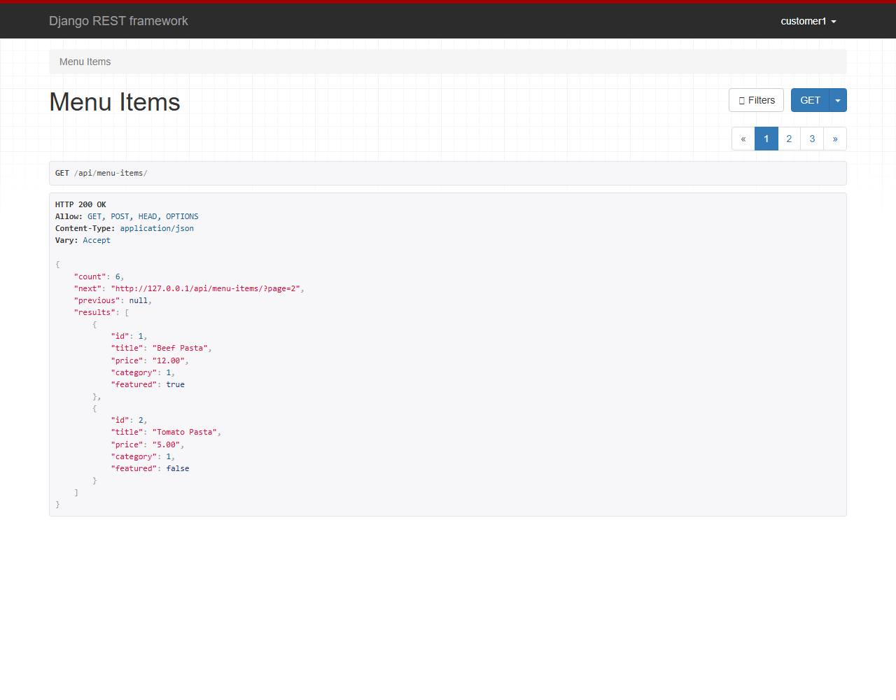
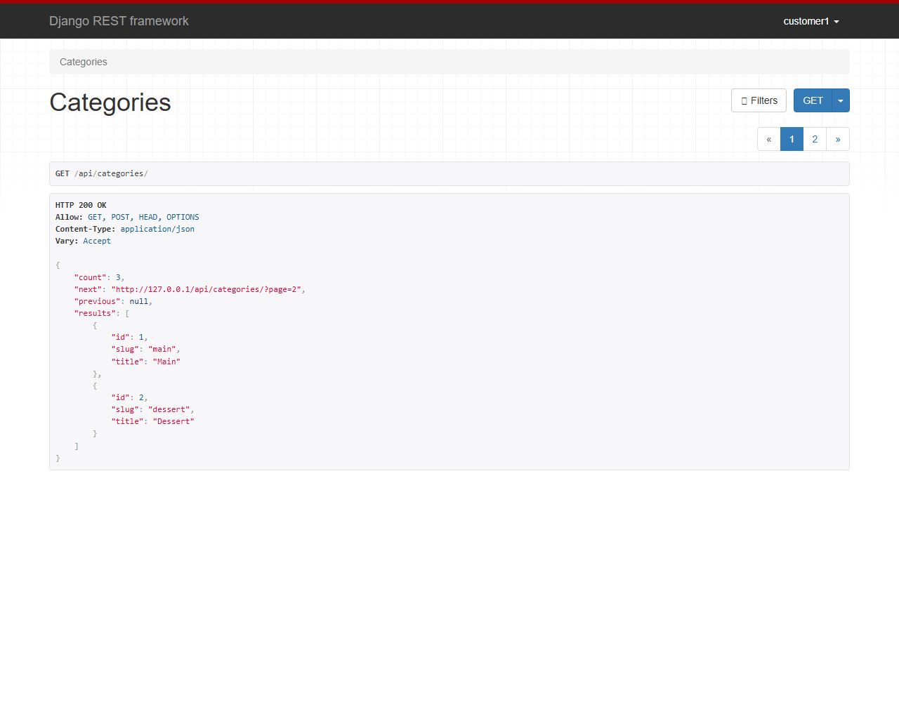
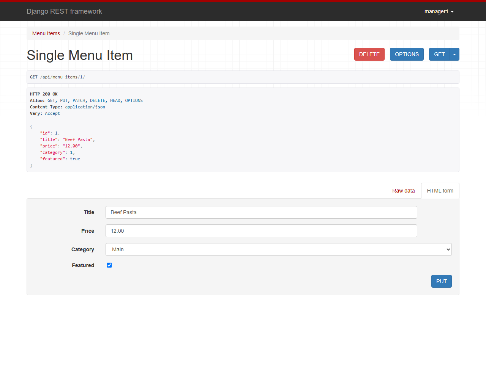
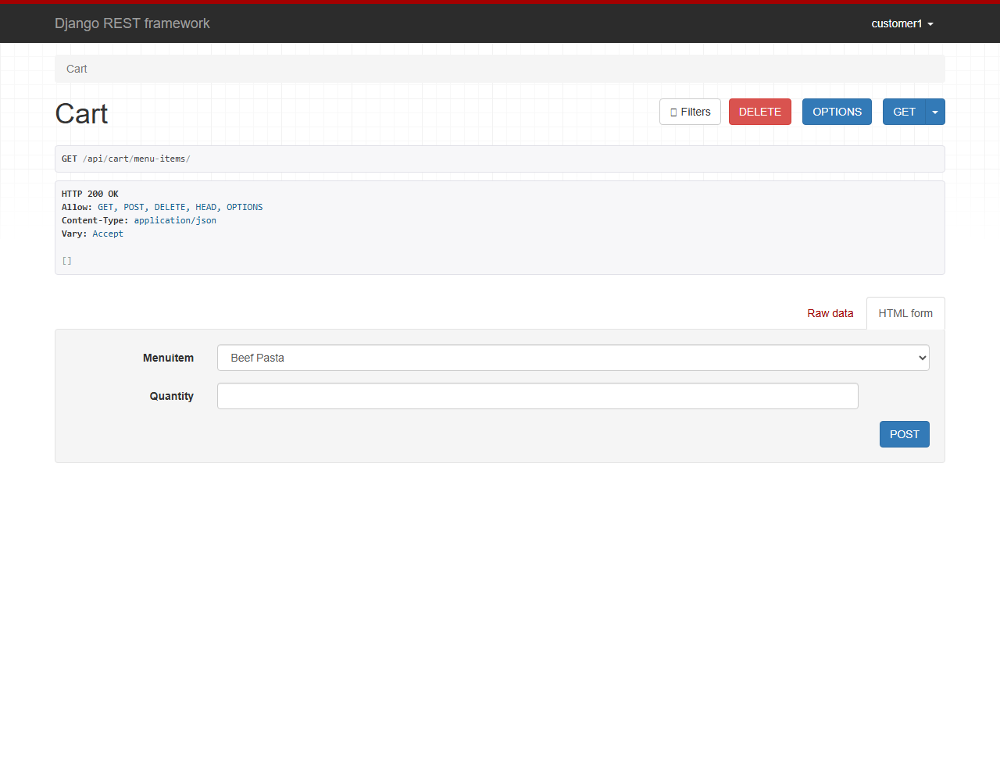
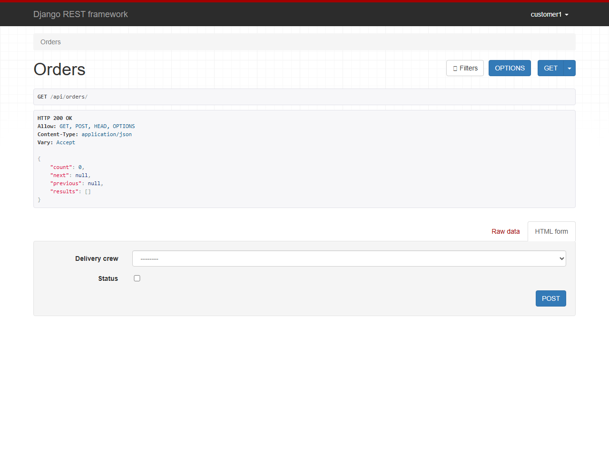
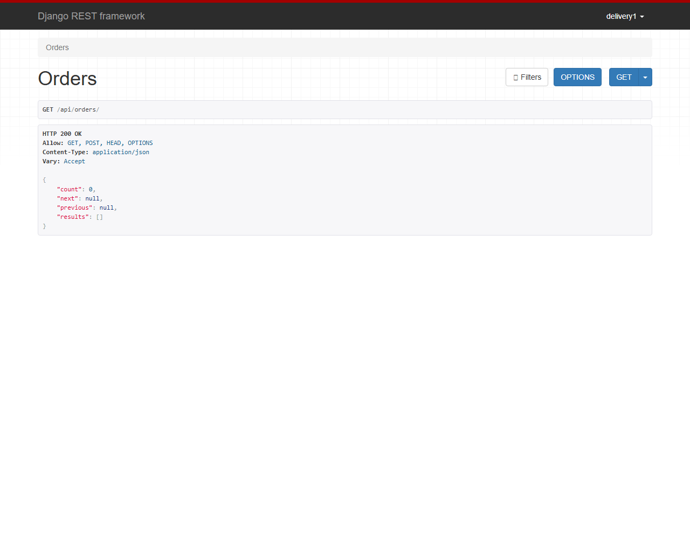
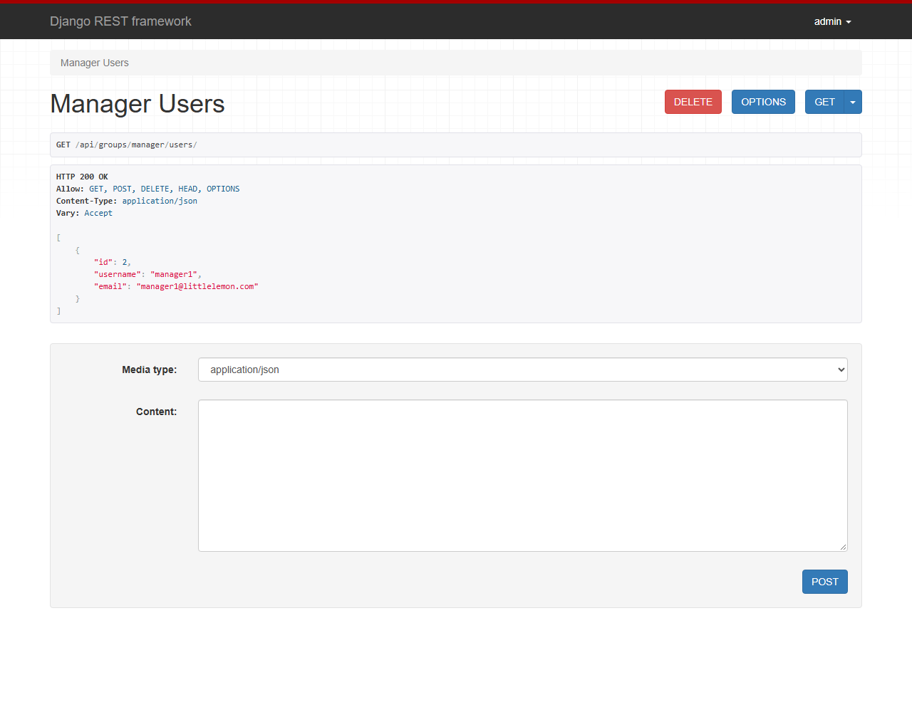
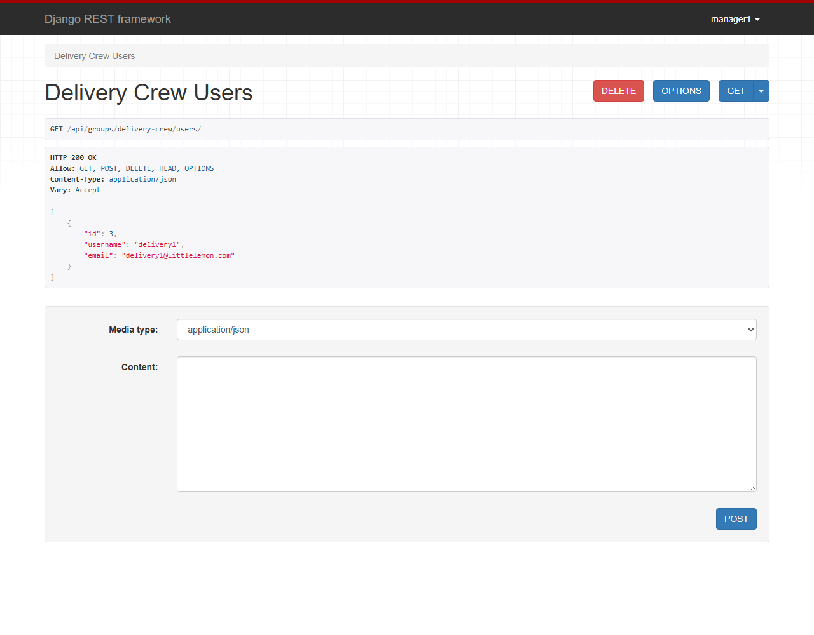
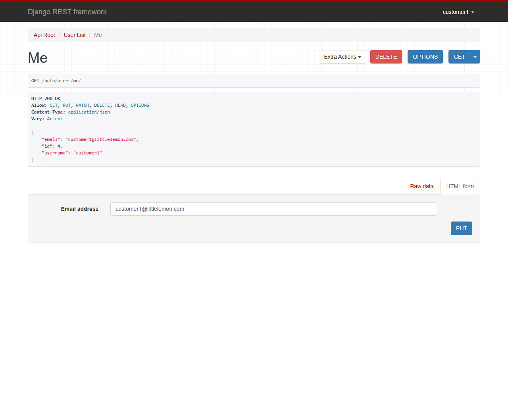
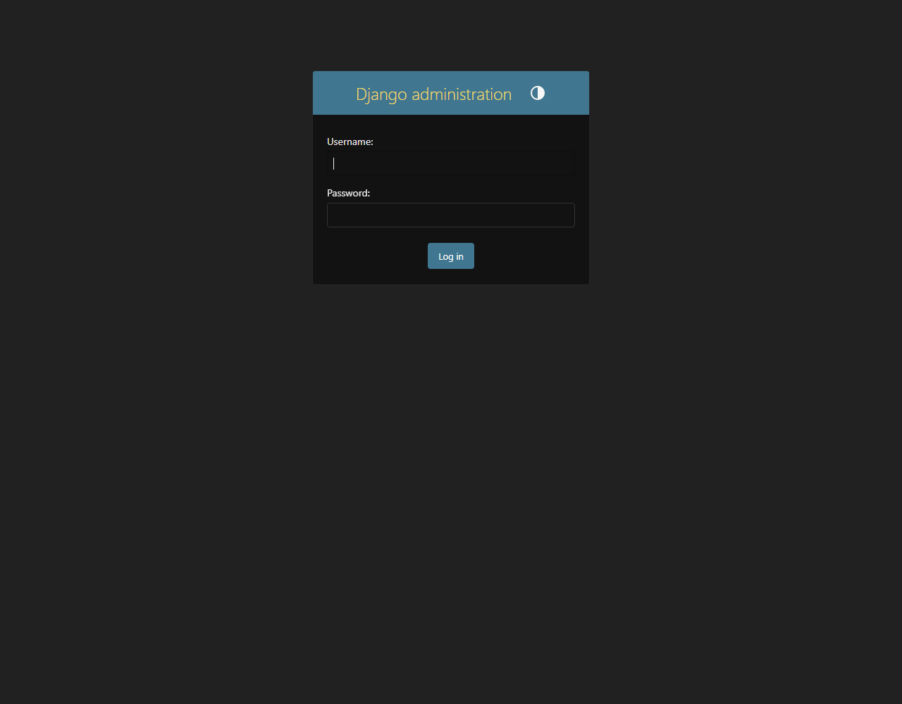

# Little Lemon API

A Django REST Framework API for the Little Lemon restaurant: menu items, categories, a customer cart, orders, and role-based access for managers, delivery crew, and customers. Authentication uses token auth through Djoser.

## Setup

```powershell
pipenv install
pipenv run python manage.py migrate
pipenv run python manage.py runserver
```

Then open http://127.0.0.1:8000/. The root redirects to `/api/menu-items/`.

`db.sqlite3` is included with sample data. Test users, passwords, tokens, and the full endpoint list are in [notes.txt](notes.txt).

## Endpoints

| Endpoint | Who can use it |
| --- | --- |
| `POST /auth/users/`, `POST /auth/token/login/` | anyone (register, get token) |
| `GET /api/menu-items`, `GET /api/categories` | any authenticated user |
| `POST/PUT/PATCH/DELETE /api/menu-items/{id}` | admin or manager |
| `/api/groups/manager/users` | admin |
| `/api/groups/delivery-crew/users` | admin or manager |
| `/api/cart/menu-items` | customers |
| `/api/orders`, `/api/orders/{id}` | customers (own), managers (all), delivery crew (assigned) |

Menu items support `?page=`, `?ordering=price`, `?category=1`, and `?search=pasta`.

## Screenshots

### Menu items (customer)


### Categories


### Single menu item (manager)


### Cart (customer)


### Orders (customer)


### Orders (delivery crew)


### Manager group (admin)


### Delivery crew group (manager)


### Current user (Djoser)


### Admin login

